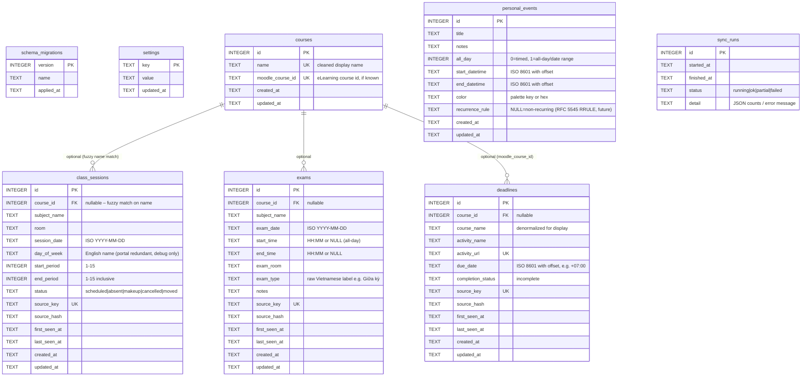

# ERD — TDTU Local Calendar Dashboard

**Status: v1.0 — FINAL for calendar scope.** Extensible by design (see
"Extending the schema"). Reviewed 2026-11-05.
Built from `docs/dataset-structure.md` (real crawler output).
SQLite, single user, single file. Personal events included from the start.



## Normalized calendar read view

The UI never reads the kind tables directly. A single SQLite view,
`calendar_events`, unifies all four sources with concrete start/end values:

```sql
CREATE VIEW calendar_events AS
  -- Class sessions: times derived from periods (50-minute periods)
  SELECT 'class'                       AS kind,
         id                            AS ref_id,
         subject_name                  AS title,
         room                          AS location,
         session_date || 'T' || period_start_time(start_period) AS start_dt,
         session_date || 'T' || period_start_time(end_period)   AS end_dt,
         0                             AS all_day,
         status                        AS tag,
         NULL                          AS recurrence_rule
  FROM class_sessions
  UNION ALL
  SELECT 'exam', id,
         subject_name, exam_room,
         exam_date || 'T' || start_time,
         exam_date || 'T' || end_time,
         CASE WHEN start_time IS NULL THEN 1 ELSE 0 END,
         COALESCE(exam_type, 'exam'),
         NULL
  FROM exams
  UNION ALL
  SELECT 'deadline', id,
         activity_name, course_name,
         due_date,              -- ISO with offset; compares as TEXT
         due_date,              -- instant; UI renders a short badge
         0,
         'deadline',
         NULL
  FROM deadlines
  UNION ALL
  SELECT 'personal', id,
         title, NULL,
         start_datetime, end_datetime,
         all_day, color,
         recurrence_rule
  FROM personal_events;
```

Encoded rules:

- **Session start/end** = `PERIOD_START[period]` / `+ 50 min`. Never stored;
  `period_start_time()` is a SQLite UDF registered by the backend (mirrors
  `time_utils.period_start_time()`).
- **Exam with NULL `start_time`** → `all_day=1` (rendered as an all-day
  banner; `end_time` ignored). **NULL `end_time`** → UI renders
  `start + 2h`.
- **Deadline** → instant row; UI shows a badge at that moment (optionally
  `+30min` block).
- All comparisons on ISO TEXT. The view is the **only contract** the
  calendar UI knows about; kind tables stay free to evolve.

## Design decisions

1. **Separate tables per event kind** instead of one polymorphic table —
   each kind has genuinely different fields; ingestion/validation stays
   simple and honest. The `calendar_events` view unifies them for reads.
2. **`courses` is a soft normalizer.** Rows link only on confident match
   (exact cleaned name; or `moodle_course_id` for deadlines). Otherwise
   `course_id` stays NULL and the denormalized name is shown. Crawls never
   fail because of naming drift.
3. **Single user**: no `users` table. `student_id`, app meta, last-crawl
   info live in `settings(key, value)`.
4. **Time & timezone**
   - `session_date` = plain `YYYY-MM-DD` (weekday derivable; stored only as
     debug aid in `day_of_week`).
   - `deadlines.due_date` keeps the crawler's `+07:00` offset — sorts as TEXT.
   - `exams` keep raw `HH:MM`; `""` from the crawler → stored as `NULL`.
   - `personal_events` store offset-aware ISO datetimes; `all_day=1` renders
     as a date-range banner (the "Vacation" badge in the mockup).
   - Session clock times are **never stored**.
5. **Idempotent ingest** (hourly crawls never stack duplicates):
   - `source_key` UNIQUE per table; `source_hash` for change detection.
   - Successful crawl of a kind reconciles **that kind only**: insert new,
     update changed, delete vanished.
   - Failed kind (`None` from `collect()`) → that table untouched;
     `sync_runs` records `partial`.
6. **`first_seen_at` / `last_seen_at`** on crawled rows enable vanish
   detection without trusting crawl timestamps alone.
7. **`sync_runs`** powers the "last updated" badge and post-mortems.
8. **Colors**: `personal_events.color` stores a palette key/hex. Crawled
   rows derive color in the UI from `kind` + `status` (mockup palette:
   cyan/blue Today, green/orange/purple/magenta tag accents).
9. **Deletion semantics**: rows vanishing from a *successful* crawl are
   **deleted** (portal is truth). Personal events are never crawler-managed.
10. **Indexes**: `session_date`, `exam_date`, `due_date`, `start_datetime`
    (grid range queries) + all `source_key`/natural uniques.

## Mapping from dataset (traceability)

| JSON path | Table.column |
|---|---|
| `schedule[].subject_name` | `class_sessions.subject_name` |
| `schedule[].room` | `class_sessions.room` |
| `schedule[].session_date` | `class_sessions.session_date` |
| `schedule[].day_of_week` | `class_sessions.day_of_week` (debug; derivable) |
| `schedule[].start_period` / `end_period` | `class_sessions.start_period` / `end_period` |
| `schedule[].status` | `class_sessions.status` |
| `schedule[].student_id` | → `settings` (single user), not stored per row |
| `exams[].subject_name` | `exams.subject_name` |
| `exams[].exam_date` | `exams.exam_date` |
| `exams[].start_time` / `end_time` | `exams.start_time` / `exams.end_time` (`""`→`NULL`) |
| `exams[].exam_room` | `exams.exam_room` |
| `exams[].exam_type` | `exams.exam_type` (raw label kept; UI maps to pills) |
| `exams[].notes` | `exams.notes` |
| `deadlines[].course_id` | `courses.moodle_course_id` (link row, on exact match) |
| `deadlines[].course_name` | `deadlines.course_name` (denormalized) |
| `deadlines[].activity_name` | `deadlines.activity_name` |
| `deadlines[].activity_url` | `deadlines.activity_url` (natural unique key) |
| `deadlines[].due_date` | `deadlines.due_date` |
| `deadlines[].completion_status` | `deadlines.completion_status` |

## Schema DDL (v1 — implemented in Step 5; kept in sync with `db/schema.sql`)

```sql
PRAGMA journal_mode = WAL;    -- concurrent reader (UI) + writer (ingest)
PRAGMA foreign_keys = ON;

CREATE TABLE settings (
  key TEXT PRIMARY KEY,
  value TEXT,
  updated_at TEXT NOT NULL
);

CREATE TABLE schema_migrations (
  version INTEGER PRIMARY KEY,
  name TEXT NOT NULL,
  applied_at TEXT NOT NULL
);

CREATE TABLE courses (
  id INTEGER PRIMARY KEY,
  name TEXT NOT NULL UNIQUE,
  moodle_course_id TEXT UNIQUE,
  created_at TEXT NOT NULL,
  updated_at TEXT NOT NULL
);

CREATE TABLE class_sessions (
  id INTEGER PRIMARY KEY,
  course_id INTEGER REFERENCES courses(id) ON DELETE SET NULL,
  subject_name TEXT NOT NULL,
  room TEXT,
  session_date TEXT NOT NULL,
  day_of_week TEXT,
  start_period INTEGER NOT NULL CHECK (start_period BETWEEN 1 AND 15),
  end_period   INTEGER NOT NULL CHECK (end_period   BETWEEN 1 AND 15),
  status TEXT NOT NULL DEFAULT 'scheduled'
    CHECK (status IN ('scheduled','absent','makeup','cancelled','moved')),
  source_key TEXT NOT NULL UNIQUE,
  source_hash TEXT NOT NULL,
  first_seen_at TEXT NOT NULL,
  last_seen_at  TEXT NOT NULL,
  created_at TEXT NOT NULL,
  updated_at TEXT NOT NULL,
  CHECK (end_period >= start_period)
);
CREATE INDEX idx_class_sessions_date ON class_sessions(session_date);

CREATE TABLE exams (
  id INTEGER PRIMARY KEY,
  course_id INTEGER REFERENCES courses(id) ON DELETE SET NULL,
  subject_name TEXT NOT NULL,
  exam_date TEXT NOT NULL,
  start_time TEXT,
  end_time TEXT,
  exam_room TEXT,
  exam_type TEXT,
  notes TEXT,
  source_key TEXT NOT NULL UNIQUE,
  source_hash TEXT NOT NULL,
  first_seen_at TEXT NOT NULL,
  last_seen_at  TEXT NOT NULL,
  created_at TEXT NOT NULL,
  updated_at TEXT NOT NULL
);
CREATE INDEX idx_exams_date ON exams(exam_date);

CREATE TABLE deadlines (
  id INTEGER PRIMARY KEY,
  course_id INTEGER REFERENCES courses(id) ON DELETE SET NULL,
  course_name TEXT,
  activity_name TEXT NOT NULL,
  activity_url TEXT NOT NULL UNIQUE,
  due_date TEXT NOT NULL,
  completion_status TEXT NOT NULL DEFAULT 'incomplete',
  source_key TEXT NOT NULL UNIQUE,
  source_hash TEXT NOT NULL,
  first_seen_at TEXT NOT NULL,
  last_seen_at  TEXT NOT NULL,
  created_at TEXT NOT NULL,
  updated_at TEXT NOT NULL
);
CREATE INDEX idx_deadlines_due ON deadlines(due_date);

CREATE TABLE personal_events (
  id INTEGER PRIMARY KEY,
  title TEXT NOT NULL,
  notes TEXT,
  all_day INTEGER NOT NULL DEFAULT 0 CHECK (all_day IN (0,1)),
  start_datetime TEXT NOT NULL,
  end_datetime   TEXT NOT NULL,
  color TEXT,
  recurrence_rule TEXT,          -- reserved; unused by v1 UI
  created_at TEXT NOT NULL,
  updated_at TEXT NOT NULL,
  CHECK (end_datetime >= start_datetime)
);
CREATE INDEX idx_personal_events_start ON personal_events(start_datetime);

CREATE TABLE sync_runs (
  id INTEGER PRIMARY KEY,
  started_at TEXT NOT NULL,
  finished_at TEXT,
  status TEXT NOT NULL DEFAULT 'running'
    CHECK (status IN ('running','ok','partial','failed')),
  detail TEXT
);
```

## Extending the schema (after calendar v1)

The v1 schema is intentionally closed over the four calendar kinds. Growth
happens by **adding new tables + one migration each**, never by reshaping
existing ones:

| Future feature (mockup tab) | Likely additions | Touches v1? |
|---|---|---|
| **Tasks** (to-do list) | new table `tasks(id, title, notes, due_date, done, priority, created_at, updated_at)`; optional `tasks.url` for eLearning-linked tasks | No — view optionally gains `UNION ALL` branch for a Tasks widget, or separate endpoint |
| **Activity / time-tracking** | new tables `activity_entries(id, started_at, ended_at, label)` | No |
| **Documents** | new table `documents(id, title, filename, mime, stored_path, created_at)`; files on disk under `data/uploads/` | No |
| **Analytics** | none — read-only SQL over existing tables + `sync_runs` | No |
| **Reminders / notifications** | new table `reminders(id, event_kind, ref_id, remind_at, sent_at)`; personal_events already reserves `recurrence_rule` | No |
| **Recurring personal events** | populate reserved `personal_events.recurrence_rule` (RFC 5545); instance expansion happens in the backend, not the DB | No DDL change |
| **Tags / color labels** | new tables `tags`, `event_tags(kind, ref_id, tag_id)` — or a JSON column if simpler | No |
| **Multi-user** (if ever) | would require a `users` table + `user_id` everywhere — **breaking change**; explicitly out of scope; avoided by single-user design | Would be migration v2, big |

Extension rules:

1. **One migration per change** (`schema_migrations`, above), numbered
   sequentially; backend applies pending migrations at startup.
2. **Backup before every migration**: the backend copies the DB file to
   `data/backups/app-YYYYmmdd-HHMMSS.db` before applying migrations.
3. **Additive only** inside tables — new nullable columns or new tables;
   no renames/drops without a data-preserving migration path.
4. **New UI surfaces read via their own endpoints**, not by widening
   `calendar_events`; the view stays exactly the calendar contract.
5. **`settings` is the feature-flag bus** (e.g. `feature.tasks = true`).

## Resolved / owner decisions (2026-11-05)

1. Portal-removed rows → **hard delete** (portal is truth). Revisit only if
   the portal misbehaves.
2. Recurring personal events → not in v1; `recurrence_rule` reserved.
3. `day_of_week` kept as debug aid; never part of identity/hashing.
4. Deadlines render as instants; `+30min` block is a UI option, not stored.
5. All-day exams (`start_time IS NULL`) → `all_day=1`.

## Open questions

None blocking v1. Revisit extension table above when scope grows.
